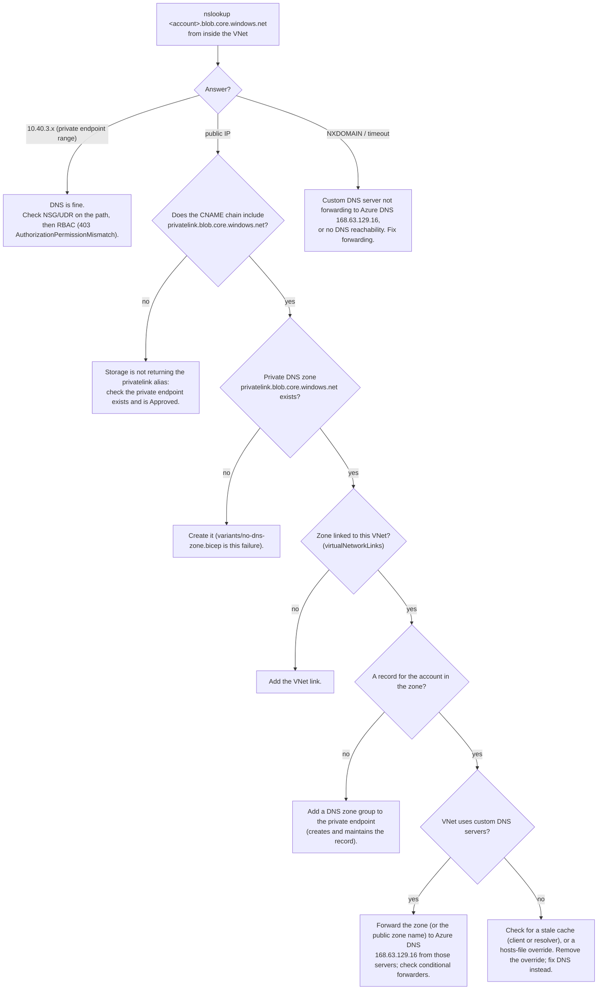

# DNS troubleshooting: "the private endpoint exists but it does not work"

Rule of thumb: **resolve first, then connect.** Most private-endpoint incidents are name-resolution incidents that surface as firewall errors.

Run every command from a machine *inside* the VNet (or one that uses the VNet's DNS path). The result from your laptop is not meaningful.

## Decision tree



## Commands

```bash
# Inside the VNet
nslookup stharbor<id>.blob.core.windows.net
getent ahostsv4 stharbor<id>.blob.core.windows.net
```

```powershell
# From anywhere with az login: is the zone, link, zone group and A record there?
az network private-dns zone show -g rg-harbor-prod -n privatelink.blob.core.windows.net
az network private-dns link vnet list -g rg-harbor-prod -z privatelink.blob.core.windows.net
az network private-endpoint dns-zone-group list -g rg-harbor-prod --endpoint-name pe-harbor-blob-prod
az network private-dns record-set a list -g rg-harbor-prod -z privatelink.blob.core.windows.net
```

`verify/assert-config.ps1` (checks C4-C7) runs these for you.

## Why the symptom is misleading

With `publicNetworkAccess: Disabled` and no private zone, the client resolves a public address, reaches the public endpoint, and is refused by the storage firewall. The error says the request is "not authorized", so people widen the firewall or add RBAC. Neither helps. Resolving the name first tells you which problem you have.

## Do not

- Add a permanent hosts-file entry. It bypasses the problem on one machine and hides it everywhere else.
- Re-enable public network access "to test". You lose the control you are trying to verify.

## Hybrid and custom DNS

If on-premises or custom DNS servers answer for the VNet, they must forward queries for the storage name (or the `privatelink` zone) to Azure DNS (168.63.129.16) from inside the VNet, or use Azure DNS Private Resolver. This repo does not deploy that; see [limits.md](limits.md).
