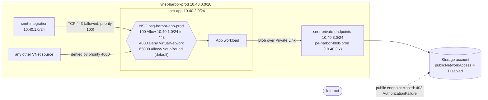
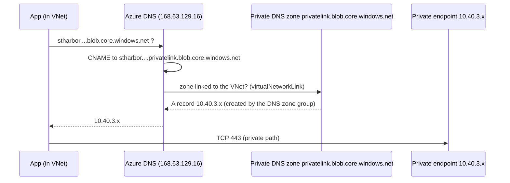

# Flow diagram

Source for the article's "building with controlled doors" figure. Render with any Mermaid renderer (GitHub renders it inline).

## Data and policy path

## DNS path (the part that is easy to forget)

If the zone, the VNet link or the zone group is missing (`variants/no-dns-zone.bicep`), the chain ends at the public IP and the private endpoint is never used. See [dns-troubleshooting.md](dns-troubleshooting.md).

## Which control closes which door

| Door | Control | Variant that leaves it open |
|---|---|---|
| App subnet reachable from any VNet source | NSG priority 4000 deny | `empty-nsg` |
| Storage public endpoint | `publicNetworkAccess: 'Disabled'` | `no-public-access-disable` |
| Clients pointed at the wrong address | Private DNS zone + link + zone group | `no-dns-zone` |
